# Poly Haven: Ceramic textures

**26 assets from [Poly Haven](https://polyhaven.com), dedicated to the public domain under [CC0](https://polyhaven.com/license).** Use them in any game, free or paid, and change them however you like; no credit is needed.

PBR textures as 1K and 2K JPG maps (colour, normal (GL and DX), roughness, AO, displacement and more). 478.4 MB in all.

This is a copy kept by [zuujis-cc0](https://github.com/zuujis-cc0) so game makers can take single files from GitHub. It is not made by or affiliated with Poly Haven: the originals, often in more formats and higher resolutions, are on [polyhaven.com](https://polyhaven.com). If they help you, consider [supporting Poly Haven](https://www.patreon.com/polyhaven/overview).

Every file is listed in [MANIFEST.tsv](MANIFEST.tsv) with its size and SHA-256. More free assets: [the Zuujis collection](https://github.com/zuujis-cc0/free-game-assets#readme).

| | | | |
| :-: | :-: | :-: | :-: |
| <a href="anti_skid_tiles">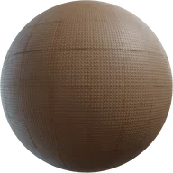</a> <b><a href="anti_skid_tiles">Anti Skid Tiles</a></b> by Amal Kumar · <a href="https://polyhaven.com/a/anti_skid_tiles">source</a> | <a href="brown_floor_tiles">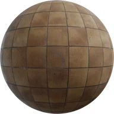</a> <b><a href="brown_floor_tiles">Brown Floor Tilles</a></b> by Rob Tuytel · <a href="https://polyhaven.com/a/brown_floor_tiles">source</a> | <a href="ceramic_roof_01">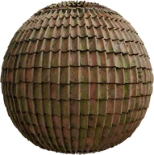</a> <b><a href="ceramic_roof_01">Ceramic Roof 01</a></b> by Rob Tuytel · <a href="https://polyhaven.com/a/ceramic_roof_01">source</a> | <a href="clay_roof_tiles">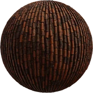</a> <b><a href="clay_roof_tiles">Clay Roof Tiles</a></b> by Amal Kumar · <a href="https://polyhaven.com/a/clay_roof_tiles">source</a> |
| <a href="clay_roof_tiles_02">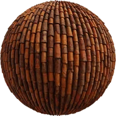</a> <b><a href="clay_roof_tiles_02">Clay Roof Tiles 02</a></b> by Amal Kumar · <a href="https://polyhaven.com/a/clay_roof_tiles_02">source</a> | <a href="clay_roof_tiles_03">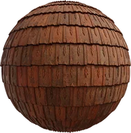</a> <b><a href="clay_roof_tiles_03">Clay Roof Tiles 03</a></b> by Amal Kumar · <a href="https://polyhaven.com/a/clay_roof_tiles_03">source</a> | <a href="dirty_tiles">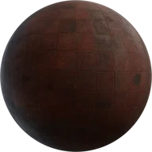</a> <b><a href="dirty_tiles">Dirty Tiles</a></b> by Jenelle van Heerden, Matterfield · <a href="https://polyhaven.com/a/dirty_tiles">source</a> | <a href="floor_tiles_08">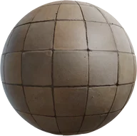</a> <b><a href="floor_tiles_08">Floor Tiles 08</a></b> by Rob Tuytel · <a href="https://polyhaven.com/a/floor_tiles_08">source</a> |
| <a href="grey_roof_01">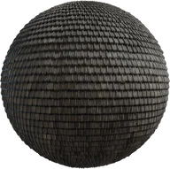</a> <b><a href="grey_roof_01">Grey Roof 01</a></b> by Rob Tuytel · <a href="https://polyhaven.com/a/grey_roof_01">source</a> | <a href="grey_roof_tiles">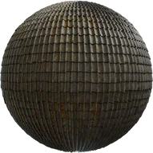</a> <b><a href="grey_roof_tiles">Grey Roof Tiles</a></b> by Rob Tuytel · <a href="https://polyhaven.com/a/grey_roof_tiles">source</a> | <a href="interior_tiles">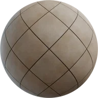</a> <b><a href="interior_tiles">Interior Tiles</a></b> by Charlotte Baglioni · <a href="https://polyhaven.com/a/interior_tiles">source</a> | <a href="long_white_tiles">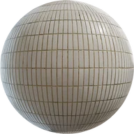</a> <b><a href="long_white_tiles">Long White Tiles</a></b> by Jenelle van Heerden, Sergej Majboroda · <a href="https://polyhaven.com/a/long_white_tiles">source</a> |
| <a href="marble_mosaic_tiles">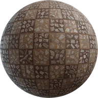</a> <b><a href="marble_mosaic_tiles">Marble Mosaic Tiles</a></b> by Amal Kumar · <a href="https://polyhaven.com/a/marble_mosaic_tiles">source</a> | <a href="old_mosaic_floor">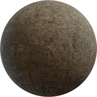</a> <b><a href="old_mosaic_floor">Old Mosaic Floor</a></b> by Amal Kumar · <a href="https://polyhaven.com/a/old_mosaic_floor">source</a> | <a href="patio_tiles">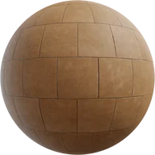</a> <b><a href="patio_tiles">Patio Tiles</a></b> by Dario Barresi · <a href="https://polyhaven.com/a/patio_tiles">source</a> | <a href="patterned_terracotta_tiling">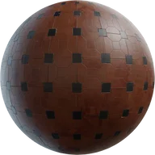</a> <b><a href="patterned_terracotta_tiling">Patterned Terracotta Tiling</a></b> by Amal Kumar · <a href="https://polyhaven.com/a/patterned_terracotta_tiling">source</a> |
| <a href="roof_07">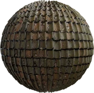</a> <b><a href="roof_07">Roof 07</a></b> by Rob Tuytel · <a href="https://polyhaven.com/a/roof_07">source</a> | <a href="roof_09">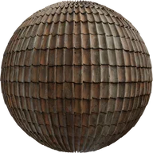</a> <b><a href="roof_09">Roof 09</a></b> by Rob Tuytel · <a href="https://polyhaven.com/a/roof_09">source</a> | <a href="roof_3">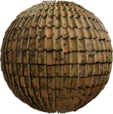</a> <b><a href="roof_3">Roof 3</a></b> by Rob Tuytel · <a href="https://polyhaven.com/a/roof_3">source</a> | <a href="roof_tiles">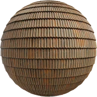</a> <b><a href="roof_tiles">Roof Tiles</a></b> by Stephan Seeliger · <a href="https://polyhaven.com/a/roof_tiles">source</a> |
| <a href="roof_tiles_14">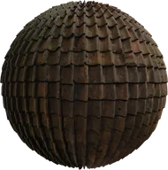</a> <b><a href="roof_tiles_14">Roof Tiles 14</a></b> by Rob Tuytel · <a href="https://polyhaven.com/a/roof_tiles_14">source</a> | <a href="rounded_square_tiled_wall">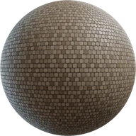</a> <b><a href="rounded_square_tiled_wall">Rounded Square Tiled Wall</a></b> by Charlotte Baglioni · <a href="https://polyhaven.com/a/rounded_square_tiled_wall">source</a> | <a href="terracotta_floor_tiles">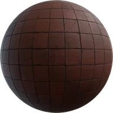</a> <b><a href="terracotta_floor_tiles">Terracotta Floor Tiles</a></b> by Dimitrios Savva · <a href="https://polyhaven.com/a/terracotta_floor_tiles">source</a> | <a href="terrazzo_tiles">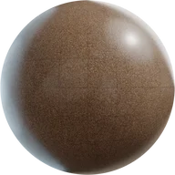</a> <b><a href="terrazzo_tiles">Terrazzo Tiles</a></b> by Amal Kumar · <a href="https://polyhaven.com/a/terrazzo_tiles">source</a> |
| <a href="tiled_floor_001">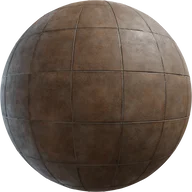</a> <b><a href="tiled_floor_001">Tiled Floor 001</a></b> by Dimitrios Savva, Rob Tuytel · <a href="https://polyhaven.com/a/tiled_floor_001">source</a> | <a href="worn_tile_floor">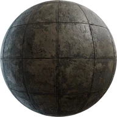</a> <b><a href="worn_tile_floor">Worn Tile Floor</a></b> by Dimitrios Savva · <a href="https://polyhaven.com/a/worn_tile_floor">source</a> |  |  |

---

Kept up to date by this repository's own [update workflow](.github/workflows/update.yml), with code and plan from [cc0-mirror](https://github.com/zuujis-cc0/cc0-mirror). Something wrong? [Open an issue there](https://github.com/zuujis-cc0/cc0-mirror/issues/new) or use the [private report form](https://games.zuujis.com/report).
